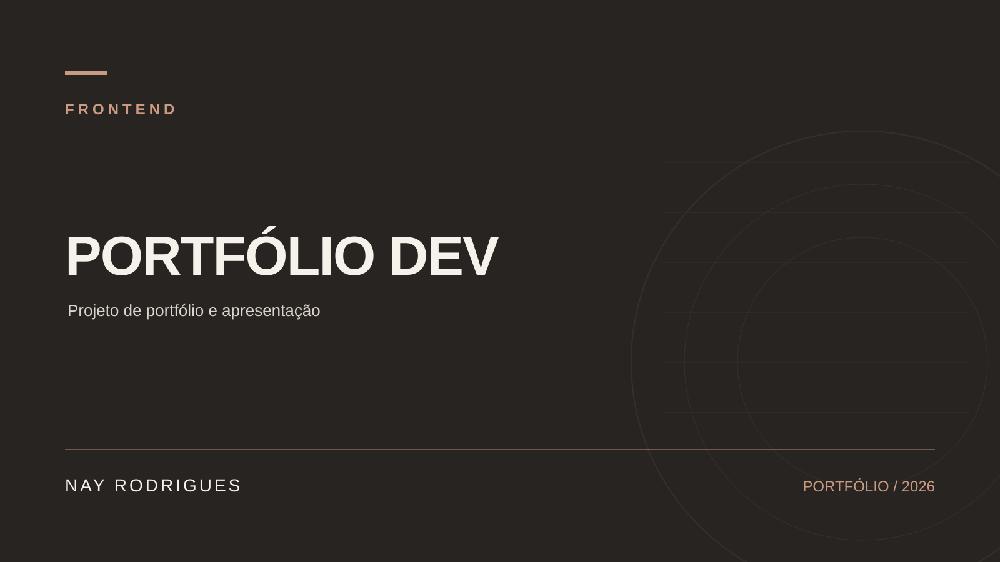

# Portfólio de desenvolvimento

Projeto de apresentação de trabalhos e estudos de desenvolvimento web

**Projeto de estudo**

## Meu portfólio 🔥

**Conheça as seções:**

- **Home:** Uma pequena apresentação sobre mim, minhas habilidades e uma visão geral das áreas que atuo.
- **Sobre:** Detalhes sobre minha formação, algumas experiências e interesses.
- **Projetos:** Uma sessão onde irei compartilhar os cases de estudos e meus projetos mais recentes, incluindo descrições e capturas de tela - mobile e desktop.
- **Daily:** Um diário de estudos em formato de vlog, onde vou compartilhar a minha jornada de aprendizado.
- **Contato:** Informações para entrar em contato comigo.

## → → Tecnologias e ferramentas Utilizadas

- **HTML5:** Para a estrutura do site
- **CSS3:** Para a estilização e layout
- **GitHub Pages:** Para hospedar e compartilhar o projeto 
